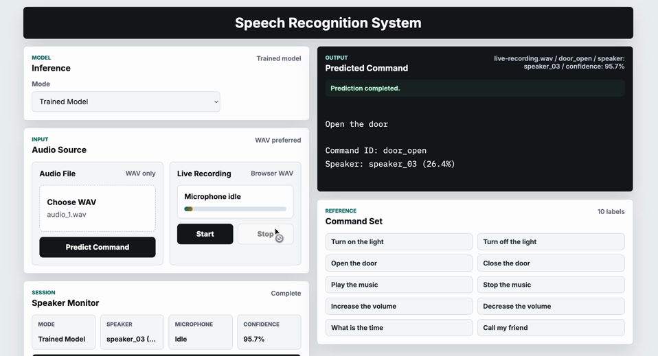
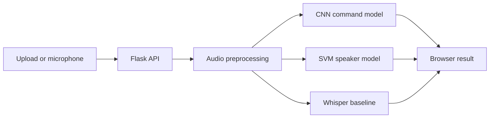

# Voice Command and Speaker Recognition

An end-to-end speech intelligence application that recognizes ten voice commands, identifies enrolled speakers, and compares a custom audio classifier with Whisper transcription.

> Portfolio status: the application, dataset pipeline, training scripts, inference API, and shipped checkpoints work locally. The project is an educational prototype, not an authentication or production speech system.



## What it demonstrates

- Audio preprocessing at 16 kHz with silence trimming and volume normalization
- A PyTorch CNN trained on log-STFT features
- Closed-set speaker identification using MFCC features and a linear SVM
- Whisper Base transcription as a general speech baseline
- Flask JSON APIs with browser upload and live microphone recording
- Reproducible evaluation outputs, tests, linting, and continuous integration

## Results

The included dataset has 300 English recordings: 10 speakers × 10 commands × 3 takes.

| Task | Model | Evaluation protocol | Result |
|---|---|---|---:|
| Command recognition | Log-STFT + CNN | Held-out third takes; known speakers | 65% accuracy |
| Command recognition | Log-STFT + CNN | Speaker 10 excluded from training and validation | 33.3% accuracy |
| Speaker identification | MFCC + linear SVM | Held-out third takes; enrolled speakers | 98% accuracy |
| Transcription | Whisper Base | Evaluation script included | Run to produce WER |

These results have important boundaries:

- “Known speakers” means the people in the command test set also have other recordings in training.
- Speaker identification is closed-set: the model selects one of ten enrolled identities.
- The dataset is small and was not designed to represent varied microphones, rooms, accents, or background noise.
- The unseen-speaker result exposes a real generalization gap and is included rather than hidden.

See the [model card](docs/model-card.md) for intended use and limitations.

## Architecture



More detail is available in [docs/architecture.md](docs/architecture.md).

The original university project report is available at [docs/project-report.pdf](docs/project-report.pdf).

## Quick start

Python 3.11 is recommended; Python 3.11–3.12 is supported.

```bash
git clone https://github.com/Abir9795/speech-intelligence-system.git
cd speech-intelligence-system
python3.11 -m venv .venv
source .venv/bin/activate
python -m pip install --upgrade pip
pip install -e .
python main.py
```

Open <http://127.0.0.1:5050>.

Windows PowerShell activation:

```powershell
.\.venv\Scripts\Activate.ps1
```

Whisper downloads its model on first use. FFmpeg is required for non-WAV Whisper uploads.

## API

| Endpoint | Method | Purpose |
|---|---|---|
| `/` | GET | Web interface |
| `/health` | GET | Health check |
| `/api/model-info` | GET | Available model metadata |
| `/api/predict-file` | POST | Run inference on an uploaded file |
| `/api/predict-recording` | POST | Run inference on a browser recording |

Upload requests use multipart form fields:

- `audio`: audio file
- `mode`: `trained` or `whisper`
- `model`: allowlisted Whisper size, default `base`

## Evaluation

Generate command metrics, predictions, and a confusion-matrix CSV:

```bash
python -m support.evaluate_command_model \
  --manifest data/custom_dataset/metadata.csv \
  --checkpoint artifacts/command_model_resplit/best_command_model.pt \
  --split test \
  --output-dir reports/command
```

Evaluate Whisper word error rate:

```bash
python -m support.evaluate_whisper \
  --manifest data/custom_dataset/metadata.csv \
  --split test
```

### Speaker-disjoint command experiment

To measure generalization to a person whose voice was not present during training:

```bash
python -m support.train_command_model \
  --manifest data/custom_dataset/metadata.csv \
  --output-dir artifacts/command_model_speaker_disjoint \
  --split-by-speaker \
  --val-speakers speaker_09 \
  --test-speakers speaker_10 \
  --epochs 60 \
  --batch-size 16 \
  --learning-rate 5e-4
```

For stronger evidence, repeat the experiment with each speaker held out and report the mean and standard deviation.

Evaluate the included speaker-disjoint checkpoint on all 30 recordings from its held-out speaker:

```bash
python -m support.evaluate_command_model \
  --checkpoint artifacts/command_model_speaker_disjoint/best_command_model.pt \
  --split all \
  --speaker-id speaker_10 \
  --output-dir reports/command_speaker_disjoint
```

## Training

Train a final command-demo model using all recordings:

```bash
python -m support.train_command_model \
  --manifest data/custom_dataset/metadata.csv \
  --output-dir artifacts/command_model \
  --train-all \
  --epochs 60 \
  --batch-size 16 \
  --learning-rate 5e-4 \
  --weight-decay 1e-4
```

Train and evaluate the speaker model:

```bash
python -m support.train_svm \
  --manifest data/custom_dataset/metadata.csv
```

The speaker evaluation uses enrolled identities and a held-out recording take. It is not unknown-speaker recognition.

## Quality checks

Install development tools and run:

```bash
pip install -e ".[dev]"
ruff check .
pytest --cov=support --cov-report=term-missing
```

GitHub Actions performs these checks on Python 3.11 and 3.12.

## Project layout

```text
.
├── artifacts/                 # Included model checkpoints
├── data/custom_dataset/       # Manifest and recordings
├── docs/                      # Architecture, model card, and privacy notes
├── reports/                   # Generated evaluation artifacts
├── static/                    # Browser JavaScript and CSS
├── support/                   # ML, evaluation, and Flask modules
├── templates/                 # Flask interface
├── tests/                     # Automated tests
├── main.py                    # Local entry point
└── pyproject.toml             # Dependencies and tool configuration
```

## Responsible publication

Voice is potentially identifying biometric data. The project owner confirmed participant permission for public redistribution. See the [privacy record](docs/privacy.md) and [dataset license](data/LICENSE.md).

The source code is available under the [MIT License](LICENSE). The dataset is available under [CC BY 4.0](data/LICENSE.md).

## Project background

This project began as a CSE445 university project and was subsequently prepared as an engineering portfolio project.
