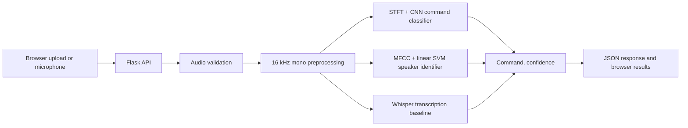

# Architecture

## Command-recognition path

Audio is decoded as 16-bit PCM, converted to mono, resampled to 16 kHz, trimmed, volume-normalized, and padded or truncated to three seconds. A normalized log-STFT is passed to a three-block convolutional neural network that predicts one of ten commands.

## Speaker-identification path

The speaker model extracts the mean and standard deviation of 13 MFCC coefficients plus mean delta coefficients. A linear support-vector classifier predicts one of the ten enrolled speakers.

This is closed-set identification: it is not designed to recognize arbitrary people, and its probability is not proof of identity.

## Whisper path

Whisper Base provides a general transcription baseline. WAV files use the project's decoder; other supported audio formats require FFmpeg.

## Operational boundaries

- The Flask server is a local demonstration server, not a hardened production deployment.
- Uploaded files are limited to 25 MB by default and removed after inference.
- Model objects are cached in process after their first use.
- The custom command model accepts WAV input only.
